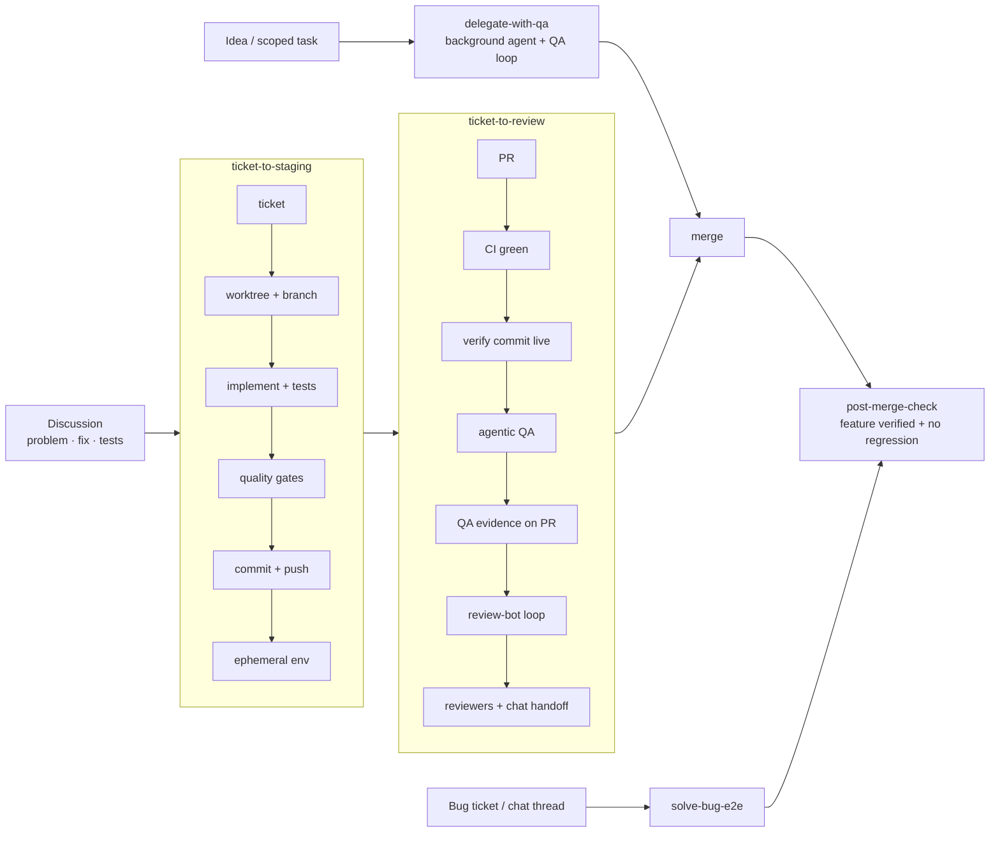

# Agentic Delivery Skills

A set of AI coding-agent **skills** that take a change from *"we agreed on the fix in chat"* all the way to *"QA'd on staging, reviewed, merged, and verified in production"* — with the agent doing the legwork and humans making the judgment calls.

These skills come from a real engineering team that uses them day to day. This repo is a **vendor-neutral** version, shared as inspiration: the skills describe *capabilities* ("ticketing system", "data warehouse", "runtime platform") instead of specific products. To run them, you need to tune them to your own stack. The goal is that you can read them and understand the **mindset and workflow**, then build your own version.

> Skills use the `SKILL.md` format (YAML front-matter `name` + `description`, followed by markdown instructions). That works with Claude Code and with other agents that support Agent Skills. Drop a folder into your agent's skills directory (e.g. `.claude/skills/<name>/SKILL.md` in a repo, or `~/.claude/skills/` for all repos).

---

## The mindset

The skills matter less than the principles behind them:

1. **Discuss first, then execute autonomously.** The human and agent converge on the problem, the fix, and the test scenarios *in conversation*. Then a single phrase ("ticket to review") hands off to an end-to-end run that doesn't stop to ask permission between phases.
2. **Explicit hard stops, everything else proceeds.** Every workflow lists the exact conditions that halt it (no concrete scope, provisioning failed, QA failed, a design judgment call). Anything not on the list, the agent handles and documents.
3. **Tooling owns branches and environments, not the agent.** Worktrees, branch names, and ephemeral environments are created by a CLI tied to the ticket. The agent never hand-rolls a branch to "get unblocked", because that drifts out of what CI/CD can deploy.
4. **Resolve inputs at runtime and remember them.** No hard-coded team, repo, base branch, or reviewers. Ask once, batched, then save to project memory.
5. **Prove the right code is running before you test it.** "CI green" and "/health returns 200" don't prove your commit is live. Check that the image/commit in the environment matches the PR HEAD.
6. **QA is evidence-based and adversarial.**
   - **Ground truth** comes from the data, independently of the API under test.
   - **Baseline vs branch:** the bug should reproduce on the main-branch baseline and be gone on the branch.
   - **Discriminating scenarios** are the exact inputs that failed before the change.
   - **Controls** are behaviors that must *not* change.
   - **LLM flows are judged at the reasoning level** (traces), by distribution rather than by a single sample.
7. **Plans are QA-aware.** When delegating to another agent, the plan must include **testability affordances** (staging-only simulation endpoints, structured log markers, queryable side effects) so the change can be observed after deploy.
8. **Self-heal with caps.** CI failures, review-bot comments, and QA failures loop through *fix → push → redeploy → re-verify*, with retry limits and a clear escalation.
9. **Put the evidence where reviewers will see it.** QA results go on the PR as a table with a merge / don't-merge recommendation, and the handoff to reviewers is posted in team chat.
10. **Shipping isn't done at merge.** After deploy, verify **the feature works in production** *and* that nothing regressed, using logs, errors, business metrics, and traces.

---

## The workflow

## The skills

### End-to-end workflows

| Skill | From → to | Composes |
|---|---|---|
| [`ticket-to-staging`](skills/ticket-to-staging/SKILL.md) | discussion → ticket → worktree → tested code → staging env | gates, commit |
| [`ticket-to-review`](skills/ticket-to-review/SKILL.md) | discussion → QA'd, bot-clean PR with reviewers + chat handoff | ticket-to-staging, create-pr, get-ci-issues, qa-staging |
| [`solve-bug-e2e`](skills/solve-bug-e2e/SKILL.md) | bug report → RCA → fix → PR → env → QA → results on PR | investigate-bug-report, generate-tests, typecheck-lint, create-pr, setup-env, get-ci-issues, qa-staging |
| [`delegate-with-qa`](skills/delegate-with-qa/SKILL.md) | scoped idea → background agent implements → agentic QA → self-heal until merge-ready | qa layers, self-heal loop |
| [`post-merge-check`](skills/post-merge-check/SKILL.md) | merged PR → deployed → N monitoring cycles → verdict | llm-trace-investigation |

### Investigation & verification

| Skill | What it does |
|---|---|
| [`investigate-bug-report`](skills/investigate-bug-report/SKILL.md) | Evidence-based RCA across ticket, chat, logs, errors, APM, warehouse, LLM traces, git history, and other services' code |
| [`qa-staging`](skills/qa-staging/SKILL.md) | Ground-truth QA on an ephemeral environment, with baseline comparison and log/trace checks |
| [`llm-trace-investigation`](skills/llm-trace-investigation/SKILL.md) | Find and read LLM/agent traces to verify behavior at the reasoning level |

### Building blocks

| Skill | What it does |
|---|---|
| [`commit-push`](skills/commit-push/SKILL.md) | Descriptive conventional commit + push |
| [`create-pr`](skills/create-pr/SKILL.md) | PR from the *full* branch diff, with enhancement vs bug-fix templates |
| [`generate-tests`](skills/generate-tests/SKILL.md) | Tests that mimic the repo's existing test style (writes, doesn't run) |
| [`typecheck-lint`](skills/typecheck-lint/SKILL.md) | Typecheck + lint, fix, repeat until clean |
| [`get-ci-issues`](skills/get-ci-issues/SKILL.md) | Structured CI failure report for the current PR |
| [`setup-env`](skills/setup-env/SKILL.md) | Request an ephemeral environment and *verify* the response |

---

## Example of real-world wiring

The skills only refer to capabilities. Here is what each capability maps to in one real production setup, to help you find your equivalent:

| Capability (as named in the skills) | Example implementation |
|---|---|
| Ticketing system | **Fibery** |
| Dev-workflow CLI (ticket → worktree + branch → env) | An **in-house CLI** that provisions a git worktree and an auto-named branch per ticket, and triggers the env |
| Ephemeral environment | A **per-ticket Kubernetes namespace** on the staging cluster, with a per-service URL on a staging domain |
| Shared baseline | The `master` deployment of each service on staging |
| Runtime platform | **Kubernetes** (`kubectl`) |
| CI system | **Argo Workflows** (moving to **GitHub Actions**) |
| Code host | **GitHub** (`gh` CLI + API) |
| Automated review bot | **Cursor Bugbot** |
| Team chat | **Slack** |
| Environment/deploy bot | An **in-house Slack bot** (older path, superseded by the CLI) |
| Background coding agent | An **in-house autonomous agent** that implements a ticket, opens a PR, and spins up an env; it reports progress in a Slack DM |
| Observability (logs, APM, metrics) | **Datadog** |
| Error tracker | **Sentry** |
| Data warehouse | **Snowflake** (with separate staging and production databases) |
| LLM tracing platform | **Langfuse** (separate staging and production projects) |
| Agent ↔ tools integration | **MCP servers** for the ticketing system, chat, observability, error tracker, warehouse, and code host |
| Coding agents | **Claude Code** and **Cursor** (plus others), sharing the same skills via an internal plugin marketplace |

---

## Adapting these to your company

1. **Map capabilities to tools.** Fill in the table above for your stack. Each skill has `> **Adapt:**` callouts at the points that need wiring.
2. **Give the agent access.** Every capability the agent can't reach becomes a blind spot. Connect each tool through an MCP server, a CLI, or an API.
3. **Replace placeholders.** The skills use:
   - `<dev-cli>`: your worktree/branch/env tool, or a script you write
   - `<background-agent>`: your remote coding agent, if you have one
   - `<ticket-id>`, `<env-id>`: your ID conventions
   - `<staging-url>`, `<baseline-url>`: your environment URL scheme
   - `<staging-dataset>`: where staging data lives in your warehouse
4. **Write down your domain knowledge.** The highest-leverage edits are company-specific facts:
   - your trace metadata schema (`llm-trace-investigation`)
   - the business metrics that define "healthy" per service (`post-merge-check`)
   - the warehouse tables to use for test data (`qa-staging`)
   - your environment's known gotchas, for example "a wildcard staging domain returns 200 even when your env is empty"
5. **Keep the hard stops and verification gates.** You can trim phases, but the main lessons are in the gates: workable ticket before provisioning, right commit live before QA, ground truth instead of HTTP 200, and evidence on the PR.
6. **Start small.** `create-pr`, `typecheck-lint`, and `qa-staging` are useful on their own. Build up to the end-to-end skills once those work well in your environment.

Feel free to fork, rewrite, and make them your own.
